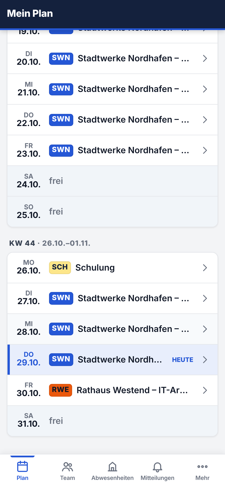
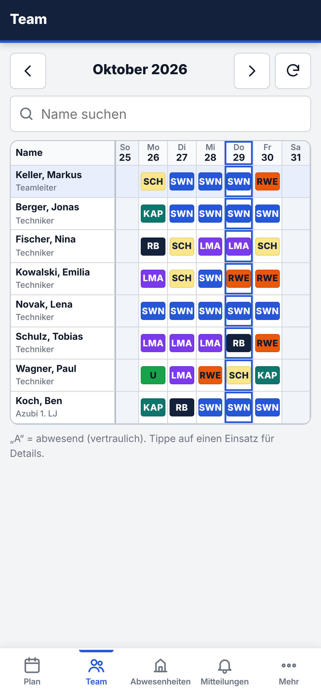
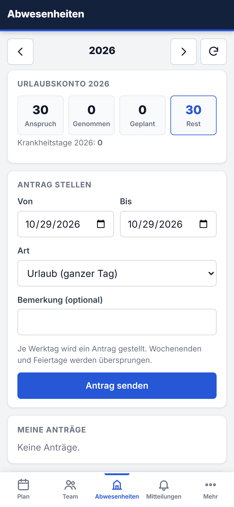
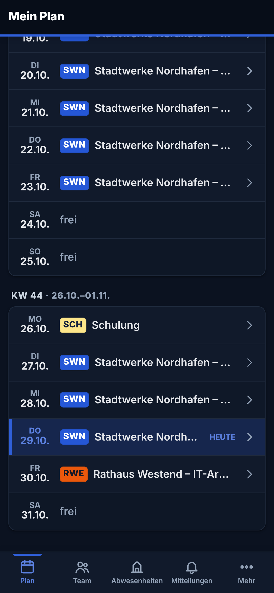

<p></p>

# Planquadro

**Einsatz- und Teamplanung für Service-Organisationen**
*Kurz: **PQ** · „Jeder Einsatz an seinem Platz.“*

Planquadro plant Einsätze, Teams, Schichten und Abwesenheiten von Außendienst- und
Vor-Ort-Teams – im Browser, als iOS-/Android-App, selbst betrieben oder als Cloud-Dienst
mit mehreren Mandanten. Mehrere Planer arbeiten gleichzeitig, ohne sich gegenseitig zu
überschreiben; vertrauliche Abwesenheitsgründe sehen nur Berechtigte.

Der Name kommt vom *Planquadrat*: Herzstück ist die Planungsmatrix aus Mitarbeitenden und
Tagen – jedes Feld ein Einsatz, jeder Einsatz an seinem Platz.

Planquadro ist aus der bewährten Anwendung *Einsatzplanung* (v6.9.0) entstanden und erweitert
sie, ohne bestehende Abläufe, Daten oder Rechte zu verändern.

> Status: Entwicklungsstand, **noch nicht für den Produktivbetrieb freigegeben**.

## Screenshots

<table>
<tr>
<td colspan="2"><br><sub>Monatsplanung – Planungsmatrix mit Einsatzcodes, Abwesenheiten und Feiertagen</sub></td>
</tr>
<tr>
<td width="50%"><br><sub>Dashboard</sub></td>
<td width="50%"><br><sub>Dunkelmodus</sub></td>
</tr>
<tr>
<td><br><sub>Gesamtplan</sub></td>
<td><br><sub>Organisation – Branding, Module, SSO</sub></td>
</tr>
</table>

**Apps für iOS und Android**

<p>




</p>

<sub>Alle Namen, Firmen und Daten sind frei erfunden (Demodaten aus <code>php bin/demo.php</code>).</sub>

## Funktionen

- **Planung:** Dashboard, Mein Plan, Gesamtplan, Monats- und Jahresplanung, Einsatzcodes,
  Dauereinsätze, Planungsassistent, Entwürfe mit Änderungsmarkierung und Veröffentlichung
- **Team & Abwesenheiten:** Mitarbeiter, Teams (Vorgesetzte), Rollen und Rechte, Urlaub,
  Krankheit, Gleitzeit, Feiertage/Ferien, Vertretungen, Änderungsanträge
- **Mehrbenutzerbetrieb:** zellgenaue Versionsprüfung mit Konfliktdialog, Sperren beim
  Speichern/Veröffentlichen, Änderungsprotokoll je Zelle, Live-Aktualisierung
- **Plattform:** Mandantenfähigkeit (eine Datenbank je Mandant), TenantConfig mit Branding,
  Modulen, Navigation, Dashboard-Widgets und Planungsregeln, Stammdaten (Kunden, Standorte,
  Qualifikationen), optional SSO per OpenID Connect, zentrale Plattform-Administration
- **Apps:** iOS/Android/PWA (`mobile/`) über die API v1 – persönlicher Plan, Team,
  Abwesenheiten und Anträge, Einsatzdetails mit Kundeninfos, Push, Offline-Lesemodus,
  Biometrie, Dark Mode, Mandanten-Branding
- **Betrieb:** Docker-Image und Compose-Stack (Self-Hosting und SaaS), Healthchecks,
  verschlüsselte Backups mit externen Zielen, Aufbewahrung, automatischem Restore-Test
  und Notfallhandbuch
- **Oberfläche:** Planquadro-Designsystem, Dark Mode, Tastaturbedienung der Planungsmatrix,
  Barrierefreiheit (WCAG 2.2 AA), deutlich schnellere große Pläne

## Dokumentation

| Dokument | Inhalt |
|---|---|
| [docs/ROADMAP.md](docs/ROADMAP.md) | Phasen, Befunde, Entscheidungen |
| [docs/ARCHITECTURE.md](docs/ARCHITECTURE.md) | Ist- und Zielarchitektur, Mandanten, Mobile-Entscheidung |
| [docs/PERMISSIONS.md](docs/PERMISSIONS.md) | Berechtigungsmodell |
| [docs/MIGRATION_PLAN.md](docs/MIGRATION_PLAN.md) | Update bestehender Installationen |
| [docs/API.md](docs/API.md) | REST-API v1 für Apps |
| [docs/BRAND.md](docs/BRAND.md) | Markenhandbuch: Name, Logo, Farben, Schrift, Ton |
| [docs/DESIGN_SYSTEM.md](docs/DESIGN_SYSTEM.md) | Designsystem, Dark Mode, Barrierefreiheit |
| [docs/DEVELOPMENT.md](docs/DEVELOPMENT.md) | Entwicklung, Tests, CI, Branches |
| [mobile/README.md](mobile/README.md) | Mobile-Apps bauen und veröffentlichen |
| [docs/INSTALLATION.md](docs/INSTALLATION.md) | Installation: Docker Compose, Reverse Proxy/HTTPS, Apache/PHP, Shared Hosting |
| [docs/CONFIGURATION.md](docs/CONFIGURATION.md) | alle Umgebungsvariablen |
| [docs/UPDATE.md](docs/UPDATE.md) | sicheres Update und Rollback |
| [docs/BACKUP.md](docs/BACKUP.md) | Backup, Verschlüsselung, Ziele, Aufbewahrung, Restore |
| [docs/DISASTER_RECOVERY.md](docs/DISASTER_RECOVERY.md) | Notfallhandbuch mit RPO/RTO |
| [CHANGELOG.md](CHANGELOG.md) | Änderungen je Version |

## Schnellstart (Entwicklung)

```bash
composer install
export PQ_DB_HOST=127.0.0.1 PQ_DB_NAME=planquadro PQ_DB_USER=planquadro PQ_DB_PASS=…
php bin/migrate.php up
php public/install.php
php bin/demo.php          # optional: Demodaten für eine Vorführinstanz
php -S 127.0.0.1:8080 -t public tests/router.php
```

## Lizenz

Copyright © 2026 Florian-Fynn Scheibel. Alle Rechte vorbehalten (siehe Roadmap, E-3).
