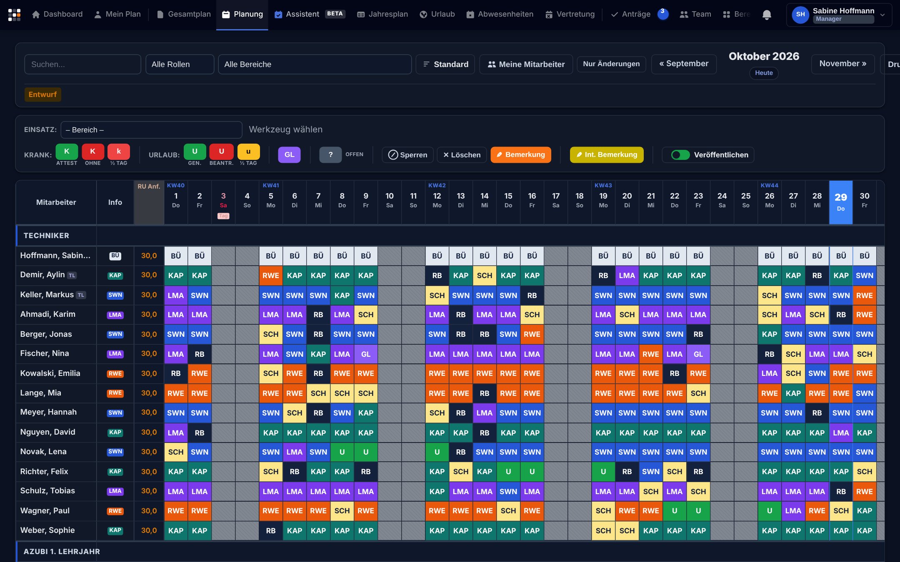
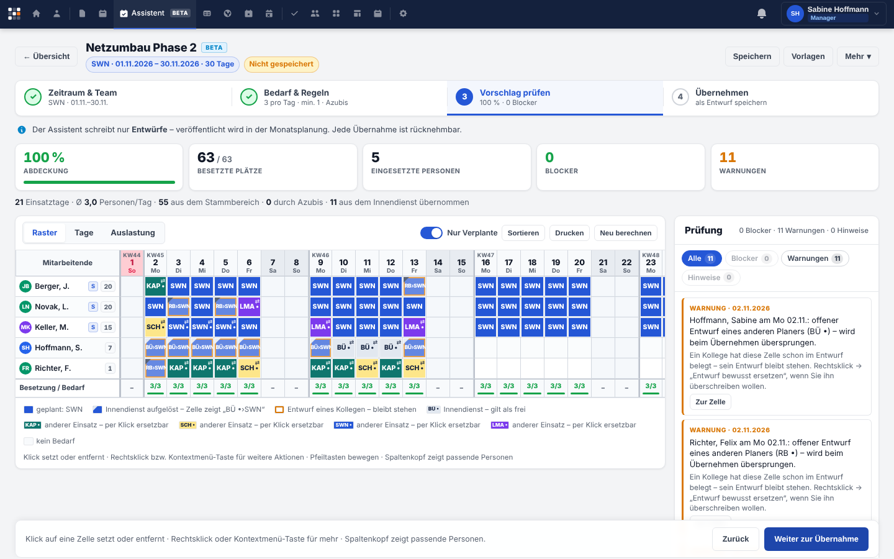
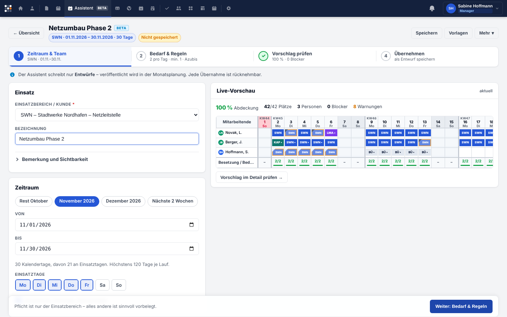

<p align="center"></p>

<h3 align="center">Einsatz- und Teamplanung für Service-Organisationen</h3>
<p align="center"><em>„Jeder Einsatz an seinem Platz.“</em></p>

<p align="center">
<a href="https://github.com/florians25/Planquadro/actions/workflows/ci.yml"></a>
<a href="https://github.com/florians25/Planquadro/releases"></a>


</p>

**Planquadro** plant Einsätze, Teams, Schichten und Abwesenheiten von Außendienst- und
Vor-Ort-Teams – im Browser, als iOS-/Android-App, selbst betrieben oder als Cloud-Dienst
mit vielen Mandanten. Mehrere Planer arbeiten gleichzeitig, ohne sich gegenseitig zu
überschreiben, und vertrauliche Abwesenheitsgründe sehen nur Berechtigte.

Der Name kommt vom *Planquadrat*: Herzstück ist die Planungsmatrix aus Mitarbeitenden und
Tagen – jedes Feld ein Einsatz. Kurzname: **PQ**.

## Warum Planquadro?

| | |
|---|---|
| 🧩 **Planen wie auf der Plantafel** | Werkzeug wählen, Felder setzen oder ziehen, Einträge per Drag & Drop verschieben – mit Maus, Touch oder komplett per Tastatur. |
| 👥 **Gemeinsam ohne Chaos** | Zellgenaue Versionsprüfung mit Konfliktdialog, Live-Aktualisierung, Änderungsprotokoll je Feld. Niemand überschreibt still die Arbeit anderer. |
| ✅ **Entwurf → Veröffentlichen** | In Ruhe planen, dann freigeben. Betroffene werden per Glocke und App-Push benachrichtigt. |
| 🔒 **Vertraulich per Design** | Krankheits- und Urlaubsgründe sehen nur Betroffene, Vorgesetzte und ausdrücklich Berechtigte – auch in API, Live-Updates und App. |
| 📱 **Apps inklusive** | iOS und Android (Capacitor) plus Web-App: eigener Plan mit Kundeninfos, Team, Urlaubsanträge, Push, Offline-Lesemodus, Face ID. |
| 🏢 **Ihr Auftritt** | Eigener Name, Farben, Logo, Domain, Module und Navigation – je Firma bzw. Mandant ([White-Label](docs/WHITE_LABEL.md)). |
| ☁️ **Self-Hosting oder SaaS** | Eine Codebasis: Docker-Compose für den eigenen Server oder Mandantenbetrieb mit einer Datenbank je Kunde. |
| 💾 **Backups, die man zurückspielen kann** | Verschlüsselt, extern (S3/rclone), mit Aufbewahrung und automatischem Restore-Test. |

## Screenshots

<table>
<tr>
<td colspan="2"><br><sub>Monatsplanung – Planungsmatrix mit Einsatzcodes, Abwesenheiten und Feiertagen</sub></td>
</tr>
<tr>
<td width="50%"><br><sub>Dashboard</sub></td>
<td width="50%"><br><sub>Dunkelmodus</sub></td>
</tr>
<tr>
<td><br><sub>Planungsassistent – Vorschlag prüfen</sub></td>
<td><br><sub>Planungsassistent – Live-Vorschau</sub></td>
</tr>
<tr>
<td><br><sub>Gesamtplan</sub></td>
<td><br><sub>Organisation – Branding, Module, SSO</sub></td>
</tr>
</table>

**Android-App** – Screenshots aus der laufenden App im Android-Emulator (automatisch erzeugt)

<p>


</p>

**iPhone & iPad** – native SwiftUI-App mit Liquid Glass (iOS 26), Screenshots aus dem iOS-Simulator ([apple/](apple/README.md))

<p>


</p>
<p> </p>

<sub>Alle Namen, Firmen und Daten sind frei erfunden (Demodaten aus <code>php bin/demo.php</code>).</sub>

## Funktionen

- **Planung:** Monats- und Jahresplanung, Gesamtplan, Mein Plan, Einsatzbereiche mit
  Kunden und Standorten, Entwürfe und Veröffentlichen, Bemerkungen (öffentlich/intern),
  Drag & Drop, Tastaturbedienung, einheitliche Filter, Druckansicht, Planungsassistent
- **Team & Abwesenheiten:** Mitarbeitende, Vorgesetzte, Urlaub, Krankheit, Gleitzeit,
  Feiertage und Ferien, Vertretungen, Anträge mit Genehmigung, Kalender-Abo (iCal)
- **Rechte:** Rechte-Katalog, Rollen inkl. eigener Rollen, Abweichungen je Person,
  Team-Scope, Vertraulichkeit; Single Sign-on (OpenID Connect) mit optionaler Rollenzuordnung
- **Zusammenarbeit:** Konfliktdialog, Sperren, Änderungsprotokoll, Live-Updates (Server-Sent
  Events), Benachrichtigungen und Push
- **Plattform:** Mandantenfähigkeit, Branding, Module, Navigation, Dashboard-Kacheln,
  Planungsregeln, Stammdaten, Plattform-Administration, REST-API v1
- **Betrieb:** Docker-Image, Compose-Stacks (einzeln, mehrere Replikate, SaaS), Healthchecks,
  verschlüsselte Backups, Restore-Test, SMTP-/Webhook-Alarme, Notfallhandbuch
- **Oberfläche:** Designsystem, Dark Mode, Barrierefreiheit (WCAG 2.2 AA), schnelle große
  Pläne

## Schnellstart mit Docker

```bash
git clone https://github.com/florians25/Planquadro.git && cd Planquadro
cp .env.example .env && sh docker/init-secrets.sh
docker compose --profile proxy up -d --build
docker compose exec app php public/install.php      # erster Administrator
docker compose exec app php bin/demo.php            # optional: Demodaten zum Ausprobieren
```

Details, HTTPS, Updates und Backups: [docs/INSTALLATION.md](docs/INSTALLATION.md).

## Dokumentation

| Für … | Dokument |
|---|---|
| **Anwender** | [Benutzerhandbuch](docs/HANDBUCH.md) · [App](mobile/README.md) |
| **Firmen & Administration** | [White-Label / eigenes Branding](docs/WHITE_LABEL.md) · [Rechte & Rollen](docs/PERMISSIONS.md) · [Markenhandbuch](docs/BRAND.md) |
| **Betrieb** | [Installation](docs/INSTALLATION.md) · [Konfiguration](docs/CONFIGURATION.md) · [Update](docs/UPDATE.md) · [Backup](docs/BACKUP.md) · [Notfallhandbuch](docs/DISASTER_RECOVERY.md) · [Migration bestehender Installationen](docs/MIGRATION_PLAN.md) |
| **Entwicklung** | [Architektur](docs/ARCHITECTURE.md) · [API v1](docs/API.md) · [Designsystem](docs/DESIGN_SYSTEM.md) · [Entwicklung & Tests](docs/DEVELOPMENT.md) · [Roadmap](docs/ROADMAP.md) · [Changelog](CHANGELOG.md) |

## Entwicklung

```bash
composer install
export PQ_DB_HOST=127.0.0.1 PQ_DB_NAME=planquadro PQ_DB_USER=planquadro PQ_DB_PASS=…
php bin/migrate.php up
php public/install.php
php bin/demo.php          # optional: Demodaten für eine Vorführinstanz
php -S 127.0.0.1:8080 -t public tests/router.php
```

Tests: `vendor/bin/phpunit` (Integrationstests gegen MariaDB/MySQL), `node --test tests/js/*.test.mjs`,
`cd mobile && npm test` – siehe [DEVELOPMENT.md](docs/DEVELOPMENT.md).

## Herkunft

Planquadro ist aus der bewährten Anwendung *Einsatzplanung* (v6.9.0) entstanden und erweitert
sie, ohne bestehende Abläufe, Daten oder Rechte zu verändern. Bestehende Installationen
lassen sich übernehmen ([MIGRATION_PLAN.md](docs/MIGRATION_PLAN.md)).

## Lizenz

Copyright © 2026 Florian-Fynn Scheibel. Alle Rechte vorbehalten (siehe Roadmap, E-3).
