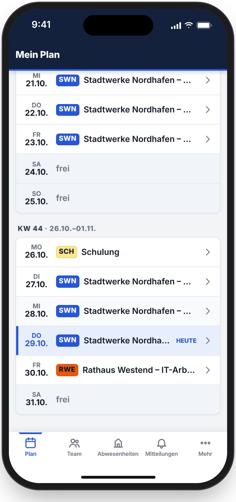
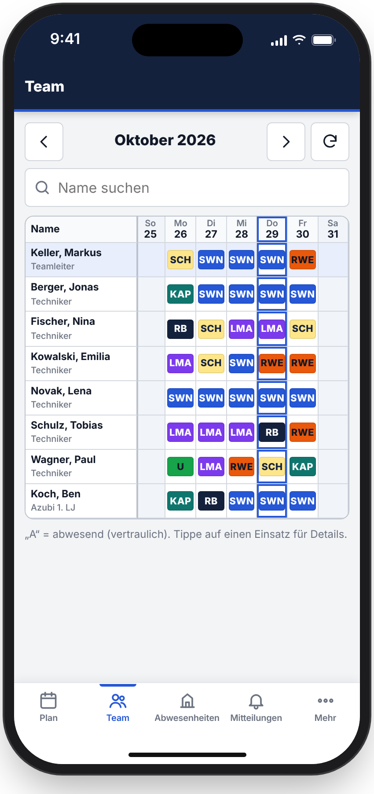
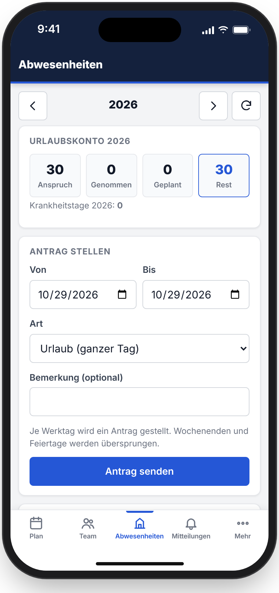
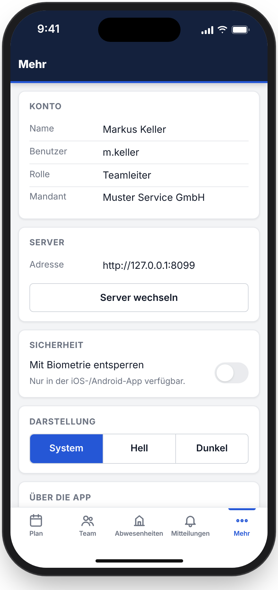

# Planquadro – Benutzerhandbuch

Für alle, die mit Planquadro planen oder ihren Plan ansehen. Installation und Betrieb
stehen in [INSTALLATION.md](INSTALLATION.md), das Anpassen an die eigene Firma in
[WHITE_LABEL.md](WHITE_LABEL.md).

**Inhalt**
1. [Grundbegriffe](#1-grundbegriffe)
2. [Anmelden](#2-anmelden)
3. [Dashboard und Mein Plan](#3-dashboard-und-mein-plan)
4. [Planen in der Monatsplanung](#4-planen-in-der-monatsplanung)
5. [Gesamtplan und Jahresplan](#5-gesamtplan-und-jahresplan)
6. [Urlaub, Abwesenheiten und Anträge](#6-urlaub-abwesenheiten-und-anträge)
7. [Vertretungen](#7-vertretungen)
8. [Planungsassistent](#8-planungsassistent)
9. [Team, Rollen und Rechte](#9-team-rollen-und-rechte)
10. [Einsatzbereiche, Stammdaten, Feiertage](#10-einsatzbereiche-stammdaten-feiertage)
11. [Organisation und Einstellungen (Administration)](#11-organisation-und-einstellungen-administration)
12. [Die App für iOS und Android](#12-die-app-für-ios-und-android)
13. [Häufige Fragen](#13-häufige-fragen)

---

## 1. Grundbegriffe

| Begriff | Bedeutung |
|---|---|
| **Planquadrat / Raster** | Die Planungsmatrix: Zeilen = Mitarbeitende, Spalten = Tage. Jedes Feld zeigt den Einsatz oder die Abwesenheit des Tages. |
| **Einsatzbereich (Einsatzcode)** | Wofür jemand eingeplant ist, z. B. ein Kunde, ein Projekt, „Büro“ oder „Schulung“ – mit Kürzel und Farbe. |
| **Abwesenheit** | Urlaub (beantragt, genehmigt, halber Tag), Krankheit (mit/ohne Attest, halber Tag), Gleitzeit, gesperrt, offen. |
| **Entwurf** | Jede Änderung im Raster ist zunächst ein Entwurf. Mitarbeitende sehen sie erst nach dem **Veröffentlichen**. |
| **Veröffentlichen** | Übernimmt die Entwürfe in den gültigen Plan; Betroffene werden benachrichtigt (Glocke, App-Push). |
| **Antrag** | Wunsch einer Mitarbeiterin oder eines Mitarbeiters (z. B. Urlaub), den Berechtigte genehmigen oder ablehnen. |
| **Team / Vorgesetzte** | Wer wen planen darf, ergibt sich aus der Vorgesetzten-Zuordnung und den Rechten der Rolle. |
| **Vertraulich** | Krankheits- und Urlaubsarten sehen nur die Person selbst, ihre Vorgesetzten und ausdrücklich Berechtigte. Alle anderen sehen nur „Abwesend“. |

## 2. Anmelden

- Im Browser die Adresse Ihrer Planquadro-Instanz öffnen, Benutzername und Passwort eingeben.
- Beim ersten Anmelden (und nach einem Zurücksetzen) vergeben Sie ein eigenes Passwort.
- Ist **Anmeldung mit Firmenkonto** eingerichtet, erscheint ein eigener Knopf (Single Sign-on).
- Nach mehreren Fehlversuchen kommt eine Rechenaufgabe, später eine kurze Sperre – zum Schutz
  vor Passwort-Raten.
- Oben rechts im Benutzermenü: **Profil** (Passwort ändern, Kalender-Abo), **Hell/Dunkel**,
  **Abmelden**. Nach längerer Inaktivität werden Sie automatisch abgemeldet.

## 3. Dashboard und Mein Plan

- **Dashboard:** Kennzahlen (Team, Resturlaub, Krank-/Gleitzeittage), Ihre Woche und die
  nächste, Planstatus der Monate, „Heute abwesend“, Mitteilungen. Welche Kacheln erscheinen,
  legt die Administration fest.
- **Mein Plan:** Ihre Einsätze und Abwesenheiten als Liste bzw. Kalender.
- **Kalender-Abo:** Im Profil finden Sie einen persönlichen iCal-Link für Outlook, Google
  oder Apple Kalender. Behandeln Sie ihn wie ein Passwort; er lässt sich neu erzeugen.

## 4. Planen in der Monatsplanung

### Werkzeug wählen und Felder setzen
1. In der Werkzeugleiste einen **Einsatzbereich** (Auswahl „Bereich“) oder eine
   **Abwesenheit** wählen: *Krank* (Attest / ohne / ½ Tag), *Urlaub* (genehmigt / beantragt /
   ½ Tag), *GL* (Gleitzeit), *?* (offen), *Sperren*, *Löschen*, *Bemerkung*, *Int. Bemerkung*.
2. Felder anklicken – oder mit gedrückter Maustaste über mehrere Tage ziehen.
3. Geänderte Felder sind als **Entwurf** markiert. Mit **Nur Änderungen** sehen Sie nur sie.
4. **Veröffentlichen**, wenn der Plan stimmt.

### Verschieben und Kopieren (Drag & Drop)
Ohne gewähltes Werkzeug lässt sich ein Eintrag mit der Maus auf ein anderes Feld ziehen:
**ziehen = verschieben**, mit **Strg/Alt** (Mac: ⌘/⌥) = **kopieren**. Gültige Ziele werden grün
umrandet, ungültige rot gestrichelt mit Begründung (Feiertag, genehmigter Urlaub,
Krankmeldung, fremde Bearbeitung …). **Esc** bricht ab.

### Tastatur
Mit den Pfeiltasten durch das Raster, **Enter**/**Leertaste** setzt das gewählte Werkzeug,
**Entf** löscht, **Strg+X / Strg+C / Strg+V** schneiden aus, kopieren, fügen ein,
**/** springt in die Suche.

### Gleichzeitig planen
Mehrere Planer können gleichzeitig arbeiten. Hat jemand ein Feld geändert, seit Sie es
geladen haben, speichert Planquadro **nicht** einfach darüber, sondern zeigt einen Dialog:
wer, wann, welcher Stand – Sie entscheiden, ob Sie überschreiben oder den neuen Stand
übernehmen. Änderungen anderer erscheinen live, ohne Neuladen.

### Filter
Suche (auch mehrere Wörter, z. B. Vor- und Nachname), Rolle, Bereich, „Meine Mitarbeiter“.
Monatsplanung und Gesamtplan haben dieselbe Filterleiste. **Zurücksetzen** hebt alle Filter auf.

### Bemerkungen
*Bemerkung* ist für die Person sichtbar, *Int. Bemerkung* nur für Planer.
Mit dem Schalter „Nicht veröffentlichen“ bleibt ein Eintrag intern.

### Drucken
**Drucken** erzeugt eine druckfreundliche Ansicht des ganzen Monats.

## 5. Gesamtplan und Jahresplan

- **Gesamtplan:** Leseansicht über alle sichtbaren Mitarbeitenden – ideal für Disposition und
  Telefon. Gleiche Filter wie in der Monatsplanung.
- **Jahresplan:** ein Jahr pro Person auf einen Blick (Einsätze, Urlaub, Abwesenheiten).

## 6. Urlaub, Abwesenheiten und Anträge

- **Anträge** (wenn das Modul aktiv ist): Mitarbeitende beantragen Urlaub oder Änderungen –
  im Browser oder in der App. Berechtigte genehmigen oder lehnen unter **Anträge** ab; das
  Ergebnis landet im Plan und als Benachrichtigung bei der Person.
- **Urlaub:** Übersicht über Ansprüche, genommene und geplante Tage; für Planer zusätzlich
  „Urlaub für alle eintragen“ (z. B. Betriebsurlaub).
- **Abwesenheiten:** längere Abwesenheiten über einen Zeitraum erfassen, inklusive
  Vertretung für die Einsätze dieser Zeit. Genehmigter Urlaub und Krankheit sind geschützt
  und werden nur mit dem Recht „Genehmigten Urlaub entsperren“ überschrieben.

## 7. Vertretungen

Unter **Vertretung** richten Sie für einen Zeitraum eine Vertretung ein (z. B. während Ihres
Urlaubs). Die Vertretung darf in dieser Zeit Ihr Team planen und Anträge bearbeiten – genau
mit Ihren Rechten, nicht mehr.

## 8. Planungsassistent

Der **Assistent** schlägt Pläne vor: Sie wählen Zeitraum, Personen und Bereiche, er verteilt
unter Berücksichtigung von Abwesenheiten, Feiertagen und Regeln. Vorschläge werden erst mit
**Übernehmen** zu Entwürfen; **Rückgängig** nimmt eine Übernahme zurück, ohne spätere
manuelle Änderungen zu verlieren. Planungen lassen sich speichern und später fortsetzen.

## 9. Team, Rollen und Rechte

- **Team:** Mitarbeitende anlegen, bearbeiten, deaktivieren; Vorgesetzte zuordnen;
  Einmalpasswort und Zugangskarte erzeugen. Ein- und Austrittsdatum begrenzen die Planung.
- **Rollen & Rechte:** Jede Rolle hat eine Liste von Rechten (z. B. „Plan bearbeiten“,
  „Anträge genehmigen“, „Krankheits-/Urlaubsdetails aller Mitarbeiter sehen“). Eigene Rollen lassen sich auf
  Basis einer bestehenden anlegen, umbenennen und löschen; einzelne Rechte können pro Person
  abweichen. Die Administrator-Rolle ist geschützt. Details: [PERMISSIONS.md](PERMISSIONS.md).

## 10. Einsatzbereiche, Stammdaten, Feiertage

- **Bereiche:** Einsatzcodes mit Name, Kürzel (max. 10 Zeichen), Farbe, Schriftfarbe, Art
  (Kunde/allgemein), Reihenfolge; optional mit Kunde und Standort verknüpft. Bereiche mit
  Einsätzen können nicht gelöscht werden – die Historie bleibt erhalten.
- **Stammdaten:** Kunden (Ansprechpartner, Telefon, Adresse, Hinweise), Standorte,
  Qualifikationen. In der App sehen Mitarbeitende zu ihrem Einsatz die Kundeninformationen.
- **Feiertage & Ferien:** Feiertage pflegen oder importieren, Schulferien als Zeiträume.

## 11. Organisation und Einstellungen (Administration)

- **Organisation:** Branding (Name, Farben, Logo – siehe [WHITE_LABEL.md](WHITE_LABEL.md)),
  Module ein/aus, Reihenfolge und Sichtbarkeit der Navigation, Dashboard-Kacheln,
  Planungsregeln, Anmeldung per Firmenkonto (nur Administratoren).
- **Einstellungen:** Sicherheit (Passwortregeln, Sperren, Sitzungsdauer), Mitteilungen,
  Wartungsmodus, **Backup** (Status, letzte Sicherung, Restore-Test, Warnungen) und weitere
  Grundeinstellungen.

## 12. Die App für iOS und Android

1. App installieren, **Server-Adresse** Ihrer Firma eingeben (erhalten Sie von der Planung).
2. Mit Benutzername/Passwort oder Firmenkonto anmelden; optional Face ID/Fingerabdruck.
3. **Plan:** Ihre Einsätze mit Details (Kunde, Adresse, Ansprechpartner) – auch offline lesbar.
4. **Team:** wer wann wo ist (vertrauliche Abwesenheiten als „A“).
5. **Abwesenheiten:** Urlaubskonto, Anträge stellen und verfolgen.
6. **Mitteilungen:** Push bei Planänderungen, die Sie betreffen.

Die App übernimmt Name, Farben und Logo Ihrer Firma. Ohne App geht alles auch im Browser
auf dem Smartphone (und als Web-App auf dem Startbildschirm).

## 13. Häufige Fragen

**Ich sehe eine Änderung nicht.** Sie ist vermutlich noch ein Entwurf – erst nach dem
Veröffentlichen sehen Mitarbeitende sie.

**Warum steht bei Kollegen nur „A“/„Abwesend“?** Gründe von Abwesenheiten sind vertraulich.

**Ich kann ein Feld nicht ändern.** Mögliche Gründe: genehmigter Urlaub/Krankheit (geschützt),
Feiertag, außerhalb des Beschäftigungszeitraums, die Person gehört nicht zu Ihrem Team, oder
jemand anderes bearbeitet die Zeile gerade.

**Passwort vergessen?** Die Administration oder Ihre Vorgesetzten erzeugen ein Einmalpasswort.

**Wo sind meine Daten?** Bei Ihrer Firma bzw. dem von ihr gewählten Betreiber – verschlüsselt
gesichert, siehe [BACKUP.md](BACKUP.md).
