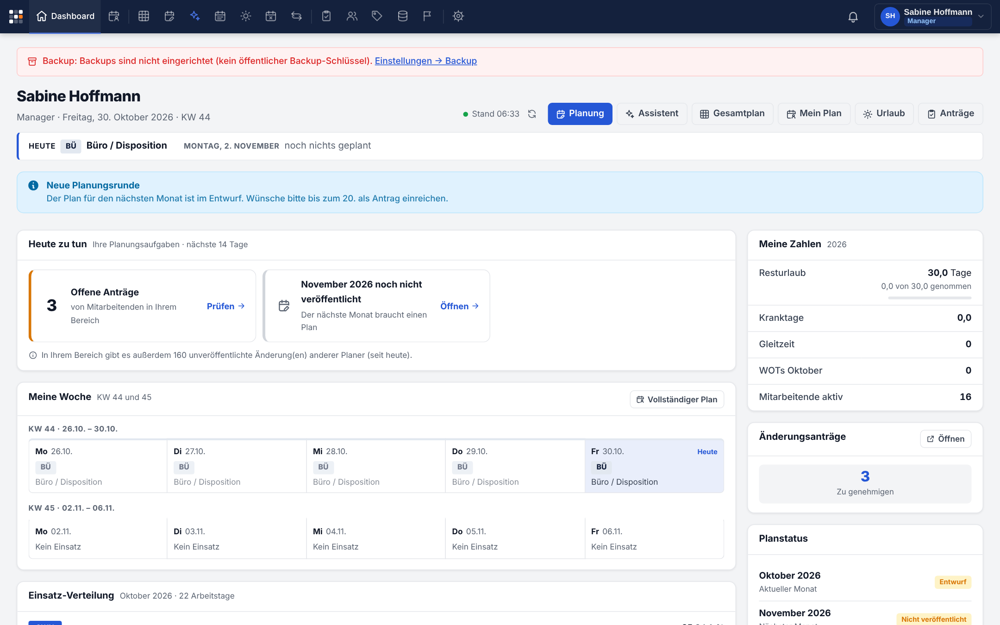
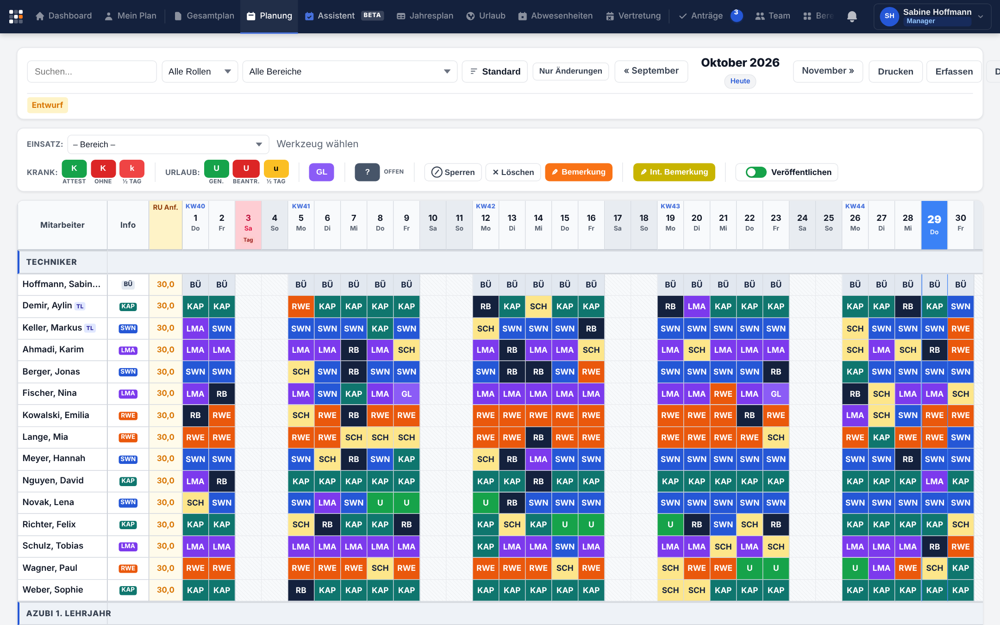
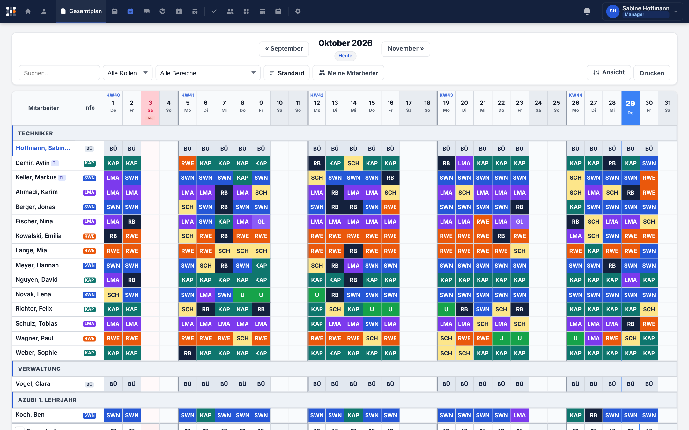
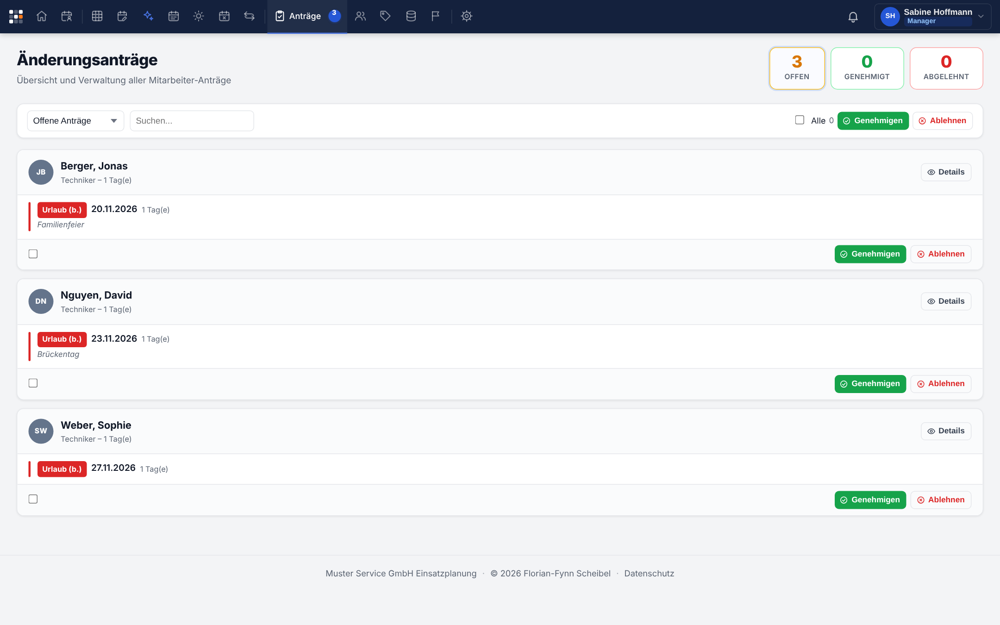
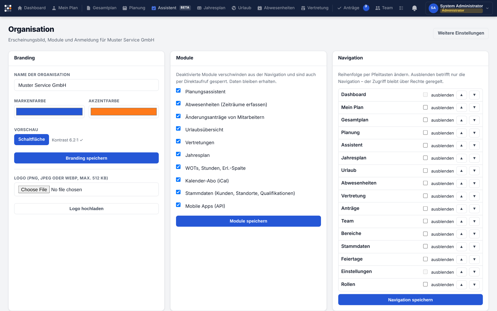

# Planquadro – Benutzerhandbuch

Für alle, die mit Planquadro planen oder ihren Plan ansehen. Installation und Betrieb
stehen in [INSTALLATION.md](INSTALLATION.md), das Anpassen an die eigene Firma in
[WHITE_LABEL.md](WHITE_LABEL.md).

**Inhalt**
1. [Grundbegriffe](#1-grundbegriffe)
2. [Anmelden](#2-anmelden)
3. [Dashboard und Mein Plan](#3-dashboard-und-mein-plan)
4. [Planen in der Monatsplanung](#4-planen-in-der-monatsplanung)
5. [Gesamtplan und Jahresplan](#5-gesamtplan-und-jahresplan)
6. [Urlaub, Abwesenheiten und Anträge](#6-urlaub-abwesenheiten-und-anträge)
7. [Vertretungen](#7-vertretungen)
8. [Planungsassistent](#8-planungsassistent)
9. [Team, Rollen und Rechte](#9-team-rollen-und-rechte)
10. [Einsatzbereiche, Stammdaten, Feiertage](#10-einsatzbereiche-stammdaten-feiertage)
11. [Organisation und Einstellungen (Administration)](#11-organisation-und-einstellungen-administration)
12. [Die App für iOS und Android](#12-die-app-für-ios-und-android)
13. [Häufige Fragen](#13-häufige-fragen)

---

## 1. Grundbegriffe

| Begriff | Bedeutung |
|---|---|
| **Planquadrat / Raster** | Die Planungsmatrix: Zeilen = Mitarbeitende, Spalten = Tage. Jedes Feld zeigt den Einsatz oder die Abwesenheit des Tages. |
| **Einsatzbereich (Einsatzcode)** | Wofür jemand eingeplant ist, z. B. ein Kunde, ein Projekt, „Büro“ oder „Schulung“ – mit Kürzel und Farbe. |
| **Abwesenheit** | Urlaub (beantragt, genehmigt, halber Tag), Krankheit (mit/ohne Attest, halber Tag), Gleitzeit, gesperrt, offen. |
| **Entwurf** | Jede Änderung im Raster ist zunächst ein Entwurf. Mitarbeitende sehen sie erst nach dem **Veröffentlichen**. |
| **Veröffentlichen** | Übernimmt die Entwürfe in den gültigen Plan; Betroffene werden benachrichtigt (Glocke, App-Push). |
| **Antrag** | Wunsch einer Mitarbeiterin oder eines Mitarbeiters (z. B. Urlaub), den Berechtigte genehmigen oder ablehnen. |
| **Team / Vorgesetzte** | Wer wen planen darf, ergibt sich aus der Vorgesetzten-Zuordnung und den Rechten der Rolle. |
| **Vertraulich** | Krankheits- und Urlaubsarten sehen nur die Person selbst, ihre Vorgesetzten und ausdrücklich Berechtigte. Alle anderen sehen nur „Abwesend“. |

## 2. Anmelden

- Im Browser die Adresse Ihrer Planquadro-Instanz öffnen, Benutzername und Passwort eingeben.
- Beim ersten Anmelden (und nach einem Zurücksetzen) vergeben Sie ein eigenes Passwort.
- Ist **Anmeldung mit Firmenkonto** eingerichtet, erscheint ein eigener Knopf (Single Sign-on).
- Nach mehreren Fehlversuchen kommt eine Rechenaufgabe, später eine kurze Sperre – zum Schutz
  vor Passwort-Raten.
- Oben rechts im Benutzermenü: **Profil** (Passwort ändern, Kalender-Abo), **Hell/Dunkel**,
  **Abmelden**. Nach längerer Inaktivität werden Sie automatisch abgemeldet.

## 3. Dashboard und Mein Plan

- **Dashboard:** Im Kopf stehen Name, Rolle, Datum und Kalenderwoche sowie Knöpfe zu Planung,
  Assistent, Gesamtplan, Mein Plan, Urlaub und Anträge (je nach Ihren Rechten). Darunter eine
  Zeile mit Ihrem Einsatz **heute** und am **nächsten Arbeitstag**.
  - **Hauptspalte:** Planer sehen zuerst **Heute zu tun** – offene Anträge (→ Prüfen),
    unveröffentlichte Entwürfe (→ Veröffentlichen), Unterbesetzung, unverplante Arbeitstage
    der nächsten 14 Tage, den noch nicht veröffentlichten Folgemonat – oder „Alles erledigt“.
    Darunter **Meine Woche** mit dieser und der nächsten Woche (Feiertage, Ferien,
    Abwesenheiten) und die **Einsatz-Verteilung** des Monats.
  - **Seitenspalte:** **Meine Zahlen** (Resturlaub, Krank-, Gleitzeittage, WOTs, aktives Team),
    Änderungsanträge, **Planstatus** mit Planungsquote, **Heute abwesend**, WOTs des Monats und
    **kommende Feiertage** mit Countdown.
  - Welche Kacheln erscheinen, legt die Administration fest (*Organisation → Dashboard-Widgets*).
- **Immer aktuell:** Das Dashboard aktualisiert sich selbst, sobald jemand plant,
  veröffentlicht oder einen Antrag stellt – ohne Neuladen. Oben rechts steht der Stand
  („Stand 14:32“): grüner Punkt = live verbunden, grauer Punkt = automatische Aktualisierung
  jede Minute, roter Punkt = keine Verbindung. Der Knopf daneben aktualisiert sofort.
- **Zahlen anklicken:** Resturlaub führt zur Urlaubsübersicht (bzw. zu „Mein Plan“),
  Krank-, Gleitzeit- und WOT-Zeilen zu „Mein Plan“, „Mitarbeitende aktiv“ zum Gesamtplan; ein
  Klick auf einen Monat im Planstatus öffnet dessen Monatsplanung.
- **Mein Plan:** Ihre Einsätze und Abwesenheiten als Liste bzw. Kalender.
- **Kalender-Abo:** Im Profil finden Sie einen persönlichen iCal-Link für Outlook, Google
  oder Apple Kalender. Behandeln Sie ihn wie ein Passwort; er lässt sich neu erzeugen.

## 4. Planen in der Monatsplanung

### Plan- und Werkzeugleiste
- **Planleiste:** Monatsnavigation zentral; links Filter, rechts Aktionen. *Erfassen*,
  *Dauereinsatz*, *Woche kopieren* und *Drucken* liegen im Menü **Mehr**, persönliche
  Einstellungen unter **Ansicht**.
- **Werkzeugleiste** in Gruppen: **Einsatz · Abwesenheit · Bearbeiten · Sichtbarkeit**. Die
  Statuszeile zeigt das aktive Werkzeug („Aktiv: Urlaub genehmigt · Esc beendet“), dazu
  *Werkzeug ablegen*, Rückgängig/Wiederholen und die Kürzel-Übersicht.
- **Bereichssuche:** Feld anklicken oder **B** drücken, Kürzel oder Namen tippen, mit den
  Pfeiltasten wählen, Eingabe übernimmt. **Zuletzt genutzt:** bis zu fünf Bereiche als
  Farbchips, auch über die Tasten **1–5**.
- **Tastenkürzel** (nicht in Eingabefeldern): **K** Krank mit Attest, **Umschalt+K** Krank
  ohne Attest, **H** Krank ½ Tag, **U** Urlaub genehmigt, **Umschalt+U** Urlaub beantragt,
  **Umschalt+H** Urlaub ½ Tag, **G** Gleitzeit, **O** Offen, **S** Sperren, **L** Löschen,
  **M** Bemerkung, **I** interne Bemerkung, **V** Veröffentlichen umschalten, **Esc** Werkzeug
  ablegen, **?** alle Kürzel.
- Wer die bisherige Anordnung bevorzugt: *Ansicht → Werkzeugleiste gruppiert* ausschalten.

### Werkzeug wählen und Felder setzen
1. In der Werkzeugleiste einen **Einsatzbereich** (Auswahl „Bereich“) oder eine
   **Abwesenheit** wählen: *Krank* (Attest / ohne / ½ Tag), *Urlaub* (genehmigt / beantragt /
   ½ Tag), *GL* (Gleitzeit), *?* (offen), *Sperren*, *Löschen*, *Bemerkung*, *Int. Bemerkung*.
2. Felder anklicken – oder mit gedrückter Maustaste über mehrere Tage ziehen.
3. Geänderte Felder sind als **Entwurf** markiert. Mit **Nur Änderungen** sehen Sie nur sie.
4. **Veröffentlichen**, wenn der Plan stimmt.

### Verschieben und Kopieren (Drag & Drop)
Ohne gewähltes Werkzeug lässt sich ein Eintrag mit der Maus auf ein anderes Feld ziehen:
**ziehen = verschieben**, mit **Strg/Alt** (Mac: ⌘/⌥) = **kopieren**. Gültige Ziele werden grün
umrandet, ungültige rot gestrichelt mit Begründung (Feiertag, genehmigter Urlaub,
Krankmeldung, fremde Bearbeitung …). **Esc** bricht ab.

### Scrollen im Plan
- Die Tabelle passt sich der Fensterhöhe an. Beim Scrollen mit dem Mausrad rutscht sie zuerst
  unter die Werkzeugleiste und bleibt dort „angedockt“; danach scrollt nur noch die Tabelle.
  Tageskopfzeile, Namensspalte, die Zeile „Eingeplant“ und die waagerechte Scrollleiste bleiben
  dabei immer sichtbar.
- **Waagerecht scrollen:** Mausrad über der Tageskopfzeile – oder Umschalt + Mausrad bzw. zwei
  Finger auf dem Touchpad irgendwo in der Tabelle.
- **Heute:** Im aktuellen Monat springt der Knopf *Heute* zur heutigen Spalte, statt die Seite
  neu zu laden. Beim Öffnen des aktuellen Monats steht der heutige Tag automatisch im Blick.
- Nach dem Veröffentlichen oder Neuladen bleibt die Scrollposition erhalten.

### Tastatur
Mit den Pfeiltasten durch das Raster, **Enter**/**Leertaste** setzt das gewählte Werkzeug,
**Entf** löscht, **Strg+X / Strg+C / Strg+V** schneiden aus, kopieren, fügen ein,
**/** springt in die Suche.

### Rückgängig, Woche kopieren
- **Strg+Z / Strg+Y** (oder die Knöpfe in der Statuszeile) machen eigene Speichervorgänge
  rückgängig bzw. wiederholen sie – bis zu 30 Schritte, auch nach dem Neuladen. Hat jemand
  die Zelle inzwischen geändert, erscheint der Konfliktdialog.
- **Mehr → Woche kopieren:** Quellwoche und Zielzeitraum wählen (Schnellwahl „Vorwoche →
  diese Woche“, „Woche → Rest des Monats“). Kopiert wird für die gefilterten Personen;
  Urlaub und Krankheit nie. Erst Vorschau, dann Konfliktprüfung.

### Abdeckung und Soll-Besetzung
Unter dem Plan zeigt die **Abdeckungszeile** je Tag, wie viele Personen eingeplant sind; ▸
schlüsselt nach Bereichen auf. Mit einer **Soll-Besetzung** je Bereich und Wochentag
(Recht „Bereiche pflegen“) erscheinen unterbesetzte Tage orange. Beim **Überfahren** eines
Feldes zeigt Planquadro Bereich, Kunde, Standort, Entwurfsstand und die letzten Änderungen;
ein Klick in die **Legende** hebt einen Bereich im Plan hervor.

### Ansicht
*Ansicht* in der Planleiste: Zeilenhöhe (Kompakt/Standard/Komfort), Abdeckungszeile,
Aufschlüsselung, Wochentrenner, Fadenkreuz, Details beim Überfahren, gruppierte
Werkzeugleiste, Werkzeug beim Monatswechsel behalten. Gilt je Browser.

### Gleichzeitig planen
Mehrere Planer können gleichzeitig arbeiten. Hat jemand ein Feld geändert, seit Sie es
geladen haben, speichert Planquadro **nicht** einfach darüber, sondern zeigt einen Dialog:
wer, wann, welcher Stand – Sie entscheiden, ob Sie überschreiben oder den neuen Stand
übernehmen. Änderungen anderer erscheinen live, ohne Neuladen.

### Filter
Suche (auch mehrere Wörter, z. B. Vor- und Nachname), Rolle, Bereich, „Meine Mitarbeiter“.
Monatsplanung und Gesamtplan haben dieselbe Filterleiste. **Zurücksetzen** hebt alle Filter auf.

### Bemerkungen
*Bemerkung* ist für die Person sichtbar, *Int. Bemerkung* nur für Planer.
Mit dem Schalter „Nicht veröffentlichen“ bleibt ein Eintrag intern.

### Drucken
**Drucken** erzeugt eine druckfreundliche Ansicht des ganzen Monats.

## 5. Gesamtplan und Jahresplan

- **Gesamtplan:** Leseansicht über alle sichtbaren Mitarbeitenden – ideal für Disposition und
  Telefon. Gleiche Filter wie in der Monatsplanung.
- **Jahresplan:** ein Jahr pro Person auf einen Blick (Einsätze, Urlaub, Abwesenheiten).

## 6. Urlaub, Abwesenheiten und Anträge

- **Anträge** (wenn das Modul aktiv ist): Mitarbeitende beantragen Urlaub oder Änderungen –
  im Browser oder in der App. Berechtigte genehmigen oder lehnen unter **Anträge** ab; das
  Ergebnis landet im Plan und als Benachrichtigung bei der Person.
- **Urlaub:** Übersicht über Ansprüche, genommene und geplante Tage; für Planer zusätzlich
  „Urlaub für alle eintragen“ (z. B. Betriebsurlaub).
- **Abwesenheiten:** längere Abwesenheiten über einen Zeitraum erfassen, inklusive
  Vertretung für die Einsätze dieser Zeit. Genehmigter Urlaub und Krankheit sind geschützt
  und werden nur mit dem Recht „Genehmigten Urlaub entsperren“ überschrieben.

## 7. Vertretungen

Unter **Vertretung** richten Sie für einen Zeitraum eine Vertretung ein (z. B. während Ihres
Urlaubs). Die Vertretung darf in dieser Zeit Ihr Team planen und Anträge bearbeiten – genau
mit Ihren Rechten, nicht mehr.

## 8. Planungsassistent

Der **Assistent** plant Einsätze und Kundenprojekte über mehrere Tage oder Wochen: Sie legen
fest, *wo*, *wann* und *wie viele* – er schlägt die Besetzung vor und beachtet dabei
Abwesenheiten, Feiertage, Berufsschule, Azubi-Regeln und Belastungsgrenzen. Übernommen wird
immer nur als **Entwurf**; veröffentlicht wird wie gewohnt in der Monatsplanung. Jede
Übernahme lässt sich mit einem Klick zurücknehmen.

Aufruf: Navigation **Assistent** oder in der Monatsplanung über die Schaltfläche
„Assistent“. Voraussetzung ist das Recht *Planungsassistent nutzen* (oder *Planen*).

### Übersicht

Die Startseite zeigt drei Bereiche:

- **Vorlagen** – gespeicherte Vorgaben wiederkehrender Einsätze. **Verwenden** startet
  eine neue Planung mit diesen Vorgaben (liegt der Zeitraum der Vorlage in der
  Vergangenheit, beginnt er heute).
- **Letzte Übernahmen** – Ihre Übernahmen, die noch Entwürfe enthalten, mit
  **Rückgängig**. Angezeigt wird, wie viele Einträge noch als Entwurf offen sind.
- **Gespeicherte Planungen** – eigene und freigegebene Planungen mit Bereich, Zeitraum,
  Abdeckung, Status (*Entwurf* oder *übernommen*). **Öffnen** prüft die Planung frisch
  gegen den aktuellen Plan und zeigt sie in Schritt 3; die gespeicherte Besetzung bleibt
  erhalten.

**Neue Planung** startet den Ablauf in vier Schritten. Die Schrittleiste oben zeigt zu
jedem Schritt eine Kurzfassung und lässt sich jederzeit anklicken.

### Schritt 1 – Zeitraum & Team

1. **Einsatzbereich / Kunde** wählen – das ist die einzige Pflichtangabe.
   Optional eine **Bezeichnung** (steht als Bemerkung an jedem Eintrag). Unter
   *Bemerkung und Sichtbarkeit*: eigene Bemerkung und „interne Eintragung“ (nur mit dem
   Recht *Interne Einträge sehen*).
2. **Zeitraum**: vorbelegt ist der Rest des Monats (bei weniger als 10 Resttagen der
   nächste Monat). Schnellwahl: *Rest des Monats*, *nächster*, *übernächster Monat*,
   *nächste 2 Wochen* – oder Von/Bis frei eintragen. Höchstens 120 Tage je Lauf.
3. **Einsatztage** (Mo–So) und ob **Feiertage** übersprungen werden.
4. **Team**: *Eigenes Team* oder – für Manager immer, für Teamleiter nur, wenn in den
   Einstellungen freigegeben – *Teamübergreifend* (bitte vorher absprechen;
   Abwesenheitsgründe anderer Teams bleiben verborgen). **Rollen** eingrenzen (ohne
   Auswahl alle). Unter *Einzelne Personen …* lassen sich Personen **fest** einplanen
   (an jedem möglichen Tag) oder **ausschließen** – mit Suche, Filtern (Stammbereich,
   Kundenerfahrung, ohne Azubis, Wochenend-Freigabe, gut umplanbar), Sortierung und
   Sammelaktionen für alle sichtbaren Personen.

Sobald Bereich und Zeitraum stehen, erscheint rechts die **Live-Vorschau**: das Raster
(Zeilen = Mitarbeitende, Spalten = Tage, farbige Kürzel) mit Abdeckung, Plätzen,
Personen, Blockern und Warnungen. Sie rechnet bei jeder Änderung neu.

### Schritt 2 – Bedarf & Regeln

- **Personen pro Tag** (Soll) und **Mindestbesetzung** (darunter: Blocker) mit −/+.
- *Je Wochentag abweichend* und *Sondertage* (Datum, Personen, Notiz; 0 nimmt den Tag
  heraus).
- **Wer passt am besten?** Stammbereich *bevorzugen*, *ausschließlich* oder *egal*,
  Mindestzahl aus dem Stammbereich, Kundenerfahrung mitgewichten; unter *Qualifikation*
  Mindest-OS-Level (mit Anzahl je Tag) und bevorzugte Ausbildungsberufe.
- **Auszubildende** einbeziehen und Lehrjahre wählen; unter *Azubi-Regeln*: höchstens
  Azubis pro Tag, reservierte Ausbildungsplätze, Höchstanteil, Betreuungsschlüssel,
  „nie allein“, Berufsschultage aussparen, kein Wochenenddienst.
- **Experten-Optionen** (eingeklappt, die Kurzfassung steht in der Überschrift):
  Tage am Stück und Tage im Zeitraum je Person, Wochenend-Freigabe beachten;
  **Umgang mit belegten Tagen** – *nichts überschreiben* (empfohlen), *andere Einsätze
  ersetzen* oder *auch Abwesenheiten* (nur mit dem Recht *Urlaub entsperren*);
  welche Innendienst-Bereiche als freie Kapazität gelten, Innendienst aktiv auflösen,
  Kundenbindung beachten; Gewichtung (Kontinuität, Gleichverteilung, Stammbereich,
  Qualifikation).

Sperrtage und Berufsschule werden **nie** überschrieben – unabhängig von jeder Einstellung.
Die Vorgaben aus *Einstellungen → Planung* sind voreingestellt.

### Schritt 3 – Vorschlag prüfen

Oben stehen die Kennzahlen (Abdeckung, besetzte Plätze, eingesetzte Personen, Blocker,
Warnungen) und eine Zeile, woher die Besetzung kommt (Stammbereich, Azubis, aufgelöster
Innendienst, ersetzte Einsätze).

- **Raster** (wie in der Monatsplanung): Klick auf eine Zelle setzt oder entfernt die
  Person. Ist die Zelle belegt, fragt der Assistent, ob der Eintrag ersetzt werden soll
  (bei Abwesenheiten mit deutlichem Hinweis). **Rechtsklick** – oder per Tastatur die
  Kontextmenü-Taste bzw. Umschalt+F10 – bietet: Tag ein-/austragen, passende Personen,
  Person ganz aus dem Vorschlag nehmen, ausschließen, an allen möglichen Tagen
  einplanen, Entwurf eines Kollegen bewusst ersetzen. Ein Klick auf den **Spaltenkopf**
  zeigt passende Personen für den Tag (leicht Umplanbare zuerst).
- **Tastatur**: Tab springt ins Raster, Pfeiltasten bewegen, Pos1/Ende zum Zeilenanfang
  bzw. -ende (mit Strg: erste/letzte Zeile), Bild auf/ab zehn Zeilen, Leertaste oder
  Eingabe schaltet die Zelle um.
- Ansichten **Raster**, **Tage** (je Tag Besetzung, nur Tage mit offenen Plätzen) und
  **Auslastung** (Tage je Person). *Nur Verplante* blendet Unbeteiligte aus,
  *Sortieren* ordnet nach aktueller Auslastung, *Drucken* öffnet eine Druckfassung
  (auch „Als PDF speichern“; enthält bewusst keine Abwesenheitsgründe).
- Die **Prüfung** rechts listet Blocker, Warnungen und Hinweise – jeweils mit einer
  Erklärung, was zu tun ist, und den Sprüngen *Zur Zelle* bzw. *Personen zeigen*.
  Ein Klick auf die Kennzahl *Blocker* oder *Warnungen* filtert die Liste.
- Zellen mit dem **offenen Entwurf eines Kollegen** sind orange umrandet: Dieser Entwurf
  bleibt bei der Übernahme stehen, außer Sie ersetzen ihn bewusst.

Ändern Sie danach noch Vorgaben, rechnet der Assistent automatisch neu – solange Sie im
Vorschlag nichts von Hand geändert haben. Mit Handänderungen erscheint stattdessen der
Hinweis **Neu berechnen** (verwirft die Handänderungen erst nach Rückfrage).

### Schritt 4 – Übernehmen

Bevor etwas gespeichert wird, prüft der Server die Übernahme und zeigt eine klare
Zusammenfassung, z. B. **„27 Einsätze für 9 Personen, 3 Konflikte übersprungen“**:
wie viele Einträge auf freie Tage fallen, Innendienst auflösen, Einsätze ersetzen oder
Abwesenheiten überschreiben, und welche Zellen aus welchem Grund **übersprungen** werden
(Sperrtag, Berufsschule, geschützte Abwesenheit, bereits geplant, offener Entwurf eines
anderen Planers, inzwischen geändert, kein Planungsrecht). Darunter stehen alle Vorgaben
im Überblick – **Ändern** springt direkt zum Feld.

**Jetzt als Entwurf übernehmen** schreibt die Entwürfe. Danach:

- **Übernahme rückgängig machen** – im Schritt 4 und oben als Hinweis „… Einträge
  übernommen · Rückgängig“; später auch auf der Startseite unter *Letzte Übernahmen*.
  Rückgängig entfernt nur die Entwürfe, die noch aus dieser Übernahme stammen; Zellen,
  die inzwischen jemand von Hand geändert hat, bleiben erhalten.
- **Zur Monatsplanung** – dort prüfen und wie gewohnt veröffentlichen.

Hat sich eine Zelle zwischen Prüfung und Übernahme geändert, wird sie übersprungen und
gemeldet. Jede Übernahme und jede Rücknahme steht im Änderungsprotokoll.

### Speichern und Vorlagen

- **Speichern** (oben) sichert Vorgaben und Besetzung als *Planung* – optional für andere
  Planende freigegeben. Eigene Planungen werden beim erneuten Speichern überschrieben,
  fremde als neue Planung angelegt. Nach einer Übernahme wird die gespeicherte Planung
  automatisch aktualisiert und als *übernommen* markiert.
- **Mehr → Als Vorlage sichern** sichert nur die Vorgaben (nicht die Besetzung), mit
  Name, Kurzbeschreibung und Freigabe. Ist eine Vorlage geladen, kann sie direkt
  aktualisiert werden. **Vorlagen** (oben) öffnet die Liste zum Verwenden oder Löschen.
- **Mehr → Zurücksetzen** verwirft alle Eingaben; **Mehr → Drucken / PDF**.

Ungespeicherte Eingaben bleiben im Browser-Tab erhalten, bis Sie ihn schließen; beim
Verlassen mit ungespeichertem Vorschlag fragt der Browser nach.

## 9. Team, Rollen und Rechte

- **Team:** Mitarbeitende anlegen, bearbeiten, deaktivieren; Vorgesetzte zuordnen;
  Einmalpasswort und Zugangskarte erzeugen. Ein- und Austrittsdatum begrenzen die Planung.
- **Rollen & Rechte:** Jede Rolle hat eine Liste von Rechten (z. B. „Plan bearbeiten“,
  „Anträge genehmigen“, „Krankheits-/Urlaubsdetails aller Mitarbeiter sehen“). Eigene Rollen lassen sich auf
  Basis einer bestehenden anlegen, umbenennen und löschen; einzelne Rechte können pro Person
  abweichen. Die Administrator-Rolle ist geschützt. Details: [PERMISSIONS.md](PERMISSIONS.md).

## 10. Einsatzbereiche, Stammdaten, Feiertage

- **Bereiche:** Einsatzcodes mit Name, Kürzel (max. 10 Zeichen), Farbe, Schriftfarbe, Art
  (Kunde/allgemein), Reihenfolge; optional mit Kunde und Standort verknüpft. Bereiche mit
  Einsätzen können nicht gelöscht werden – die Historie bleibt erhalten.
- **Stammdaten:** Kunden (Ansprechpartner, Telefon, Adresse, Hinweise), Standorte,
  Qualifikationen. In der App sehen Mitarbeitende zu ihrem Einsatz die Kundeninformationen.
- **Feiertage & Ferien:** Feiertage pflegen oder importieren, Schulferien als Zeiträume.

## 11. Organisation und Einstellungen (Administration)

- **Organisation:** Branding (Name, Farben, Logo – siehe [WHITE_LABEL.md](WHITE_LABEL.md)),
  Module ein/aus, Reihenfolge und Sichtbarkeit der Navigation, Dashboard-Kacheln,
  Planungsregeln, Anmeldung per Firmenkonto (nur Administratoren).
- **Einstellungen:** Sicherheit (Passwortregeln, Sperren, Sitzungsdauer), Mitteilungen,
  Wartungsmodus, **Backup** (Status, letzte Sicherung, Restore-Test, Warnungen) und weitere
  Grundeinstellungen.

## 12. Die App für iOS und Android

1. App installieren, **Server-Adresse** Ihrer Firma eingeben (erhalten Sie von der Planung).
2. Mit Benutzername/Passwort oder Firmenkonto anmelden; optional Face ID/Fingerabdruck.
3. **Plan:** Ihre Einsätze mit Details (Kunde, Adresse, Ansprechpartner) – auch offline lesbar.
4. **Team:** wer wann wo ist (vertrauliche Abwesenheiten als „A“).
5. **Abwesenheiten:** Urlaubskonto, Anträge stellen und verfolgen.
6. **Mitteilungen:** Push bei Planänderungen, die Sie betreffen.

Die App übernimmt Name, Farben und Logo Ihrer Firma. Ohne App geht alles auch im Browser
auf dem Smartphone (und als Web-App auf dem Startbildschirm).

**Native Funktionen der App**

| Funktion | So geht’s | Hinweis |
|---|---|---|
| **Widget „Diese Woche“** (Android) | Startbildschirm lange antippen → *Widgets* → *Planquadro* | Zeigt heute und die nächsten Tage: Kürzel und Bereich Ihrer eigenen Einsätze. Abwesenheiten stehen nur als „Abwesend“ da, nie mit Grund. Tippen öffnet den Tag in der App. Aktualisiert sich nach jedem Abgleich. |
| **Schnellaktionen** (Android) | App-Symbol lange antippen | „Mein Plan“ und „Urlaub beantragen“ (öffnet das Antragsformular). |
| **Teilen** | Einsatzdetails → *Teilen* | Teilt Datum, Bereich und Einsatzort – keine Kontakte, Bemerkungen oder Kolleginnen/Kollegen. Nur für eigene Tage. |
| **In den Kalender** | Einsatzdetails → *In Kalender* (einzelner Termin mit Dialog) oder *Mehr → Nächste 14 Tage in den Kalender übernehmen* | Nur eigene Einsätze als ganztägige Termine. Erneutes Übernehmen ersetzt die früher angelegten Termine, es entstehen keine Doppelungen. Beim ersten Mal fragt das Gerät nach der Kalenderberechtigung. |
| **Erinnerung am Vorabend** | *Mehr → Erinnerung am Vorabend* | Lokale Benachrichtigung um 18 Uhr vor jedem Einsatz – funktioniert auch, wenn Ihre Firma keine Push-Nachrichten eingerichtet hat. Standard: aus. |
| **Zurück-Taste** (Android) | – | Führt innerhalb der App zurück (Details → Plan, andere Bereiche → „Mein Plan“); erst auf „Mein Plan“ geht die App in den Hintergrund. |
| **Links in die App** | z. B. aus einer Mitteilung oder einem Chat | `planquadro://tag/2026-11-02` öffnet einen Tag, `planquadro://antrag` das Antragsformular. |

Beim Abmelden werden Widget-Inhalt und geplante Erinnerungen gelöscht; bereits übernommene
Kalendertermine bleiben in Ihrem Kalender (sie gehören Ihnen) und können dort gelöscht werden.

### iPhone & iPad

Auf iPhone und iPad ist Planquadro eine native App im neuen Apple-Design (Liquid Glass ab
iOS 26, ab iOS 17 nutzbar). Zusätzlich zu den Punkten oben:

- **Plan als Woche oder Monat:** Oben umschalten; in der Woche zeigt eine Karte den
  heutigen Einsatz. „Heute“ ist immer orange markiert. Ein Tipp auf einen Einsatz öffnet die
  Details – die Adresse öffnet Apple Karten, die Telefonnummer ruft an, „Teilen“ schickt die
  Einsatzdaten, „In Kalender eintragen“ legt einen Termin an.
- **Team-Raster** wie in der Planungsmatrix: Zeilen sind Personen, Spalten Tage. Mit der
  Suche finden Sie Namen auch ohne Akzente. Bei Kolleginnen und Kollegen steht bei
  vertraulichen Abwesenheiten nur „A“.
- **Widgets:** Home-Bildschirm gedrückt halten → *Bearbeiten* → *Widget hinzufügen* →
  Planquadro: „Heute“, „Diese Woche“ und Sperrbildschirm-Widgets. Sie zeigen nur Ihre eigenen
  Einsätze; Abwesenheiten erscheinen dort nur als „Abwesend“, weil der Sperrbildschirm auch
  für andere sichtbar ist. Unter *Mehr → Widgets* sehen Sie eine Vorschau.
- **Live-Aktivität:** Im Plan über *Aktionen → Live-Aktivität für heute* (oder automatisch,
  siehe *Mehr*) erscheint Ihr heutiger Einsatz auf dem Sperrbildschirm und in der Dynamic
  Island.
- **Siri und Kurzbefehle:** „Wo bin ich morgen eingesetzt in Planquadro?“, „Zeig meinen
  Plan in Planquadro“, „Urlaub beantragen in Planquadro“. Die Antwort auf die erste Frage
  kommt ohne die App zu öffnen.
- **Kalender:** *Mehr → Kalender abonnieren* hält Apple Kalender automatisch aktuell (der
  Link ist privat). *Einsätze in Kalender übernehmen* trägt die Einsätze dieses und des
  nächsten Monats einmalig als ganztägige Termine ein – Abwesenheiten nie.
- **Face ID / Touch ID:** unter *Mehr → Sicherheit*. Danach ist die App beim Start und nach
  mehr als fünf Minuten im Hintergrund gesperrt; im App-Umschalter ist der Inhalt verdeckt.
- **Offline:** Ohne Netz sehen Sie den zuletzt geladenen Stand mit dem Hinweis
  „Offline – Stand: …“. Anträge und „Gelesen“ gehen erst wieder online. Änderungen kommen
  im Vordergrund sofort (Live-Aktualisierung), sonst per Mitteilung.
- **iPad:** Seitenleiste statt Tab-Leiste; mit Tastatur ⌘1–⌘5 für die Bereiche, ⌘N für einen
  neuen Antrag, ⌘R zum Aktualisieren, ⌘← / ⌘→ blättert, ⌘T springt zu heute.
- **Suche:** eigener Tab (Lupe) – Einsätze nach Kürzel, Kunde oder Datum, Personen nach Namen.

## 13. Häufige Fragen

**Ich sehe eine Änderung nicht.** Sie ist vermutlich noch ein Entwurf – erst nach dem
Veröffentlichen sehen Mitarbeitende sie.

**Warum steht bei Kollegen nur „A“/„Abwesend“?** Gründe von Abwesenheiten sind vertraulich.

**Ich kann ein Feld nicht ändern.** Mögliche Gründe: genehmigter Urlaub/Krankheit (geschützt),
Feiertag, außerhalb des Beschäftigungszeitraums, die Person gehört nicht zu Ihrem Team, oder
jemand anderes bearbeitet die Zeile gerade.

**Passwort vergessen?** Die Administration oder Ihre Vorgesetzten erzeugen ein Einmalpasswort.

**Wo sind meine Daten?** Bei Ihrer Firma bzw. dem von ihr gewählten Betreiber – verschlüsselt
gesichert, siehe [BACKUP.md](BACKUP.md).
